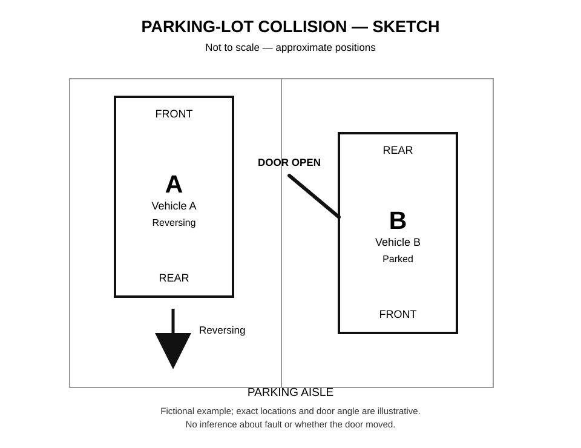

# 🚗 Collision Scene Diagram Skill

**A small, evidence-aware skill for clear, editable collision sketches.**

Turn a plain-language vehicle collision account into a simple **top-down diagram** with two labelled vehicles, front/rear orientation, doors, movement arrows, and parking-space boundaries. Useful for making a *sketch to review or copy onto a report form* when precise geometry is unavailable.



> **Fictional demonstration.** Positions and door angle are illustrative, not an exact reconstruction. The skill neither determines fault nor substitutes for police or insurance advice.

## What is included

- [`SKILL.md`](SKILL.md): AI-agent instructions, evidence-handling workflow, privacy safeguards and honest uncertainty language.
- [`scripts/render_diagram.py`](scripts/render_diagram.py): **zero-dependency Python 3.9+** generator for editable SVGs (text and shapes, no raster tracing).
- [`examples/fictional_parking_lot.json`](examples/fictional_parking_lot.json): reusable, entirely fictional example input.
- [`examples/fictional_parking_lot.svg`](examples/fictional_parking_lot.svg): printable SVG preview.
- [`tests/test_render.py`](tests/test_render.py): simple validation tests.

## Try it

```bash
python scripts/render_diagram.py examples/fictional_parking_lot.json \
  -o my_sketch.svg
python -m unittest discover -s tests -v
```

Open `my_sketch.svg` in a browser. Edit the JSON to reposition the vehicles, flip FRONT/REAR, move an arrow, or change a door's displayed angle. Save as SVG; convert to PNG using your preferred drawing application when necessary.

## Use it with an AI assistant

1. Supply only the facts needed for a diagram: vehicle locations, headings, door state and direction of travel.
2. Ask the assistant to follow `SKILL.md`, separate **seen / reported / unknown**, create scene JSON, and render an SVG.
3. Review against your evidence. Correct any assumptions before using the sketch in official paperwork.

A useful prompt:

> Make an A/B top-down collision sketch following this Skill. Show each vehicle’s front/rear and the reported movement arrow. If door movement, relative distance, orientation or contact position is unverified, label it uncertain; do not guess and do not assign fault. Give me an editable SVG and a three-step hand-drawing fallback.

## Limits and privacy

This is a **visual communication tool**, not crash reconstruction software. A single camera angle may make a stationary object appear to move as the recording vehicle changes position. Time overlays and speed readouts do not establish causation by themselves. Do not silently transform “I did not see it” into “it was not there.”

**Never publish** real collision footage, police report numbers, license plates, names, insurance details, phone numbers, precise incident locations, or statements without permission. This repository contains **only fictional data** and no real-world case material.

## License

No open-source license is included at this time. Copyright is retained by the repository owner; reuse permissions can be specified in a future license.